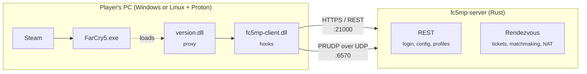

<div align="center">

# FC5MP

**A community server platform for Far Cry 5. The goal is campaign co-op for more than two players.**

*Think FiveM, but for Hope County.*


[What it is](#what-it-is) · [Status](#where-things-stand) · [How it works](#how-it-works) · [Quick start](#quick-start) · [Troubleshooting](#troubleshooting) · [Repo map](#repo-map) · [Glossary](#glossary)

</div>

---

## What it is

Far Cry 5 ships with two-player campaign co-op, and it relies on Ubisoft's online services to connect the players. FC5MP swaps those services for a server you run yourself, then widens the game's player limit.

The approach:

- **You launch a copy of the game you own, the normal way.** FC5MP is loaded alongside it.
- **A small injected library, the "client", changes the game's behaviour while it runs.** It sends the game's online traffic to our server and not to Ubisoft's. Nothing on disk is patched.
- **Our server answers every request the game makes.** It covers login, configuration, matchmaking and the peer-to-peer handshake.

> [!NOTE]
> **v1 scope:** up to 4 players in the host's campaign. Everyone can play missions and take outposts. Story progress saves for the host only, the same as vanilla co-op. There's no host migration and no Versus mode.

---

## Where things stand

| Stage | | Notes |
|---|:---:|---|
| Game launches with FC5MP loaded | ✅ | Steam → Proton → our proxy DLL → hooks installed |
| In-game login against our server | ✅ | TLS + REST auth served locally |
| Menu → load save → gameplay | ✅ | Fully playable solo through our stack |
| Rendezvous / matchmaking (PRUDP) | 🚧 | The third TLS connection fails, which blocks the co-op handshake |
| Two-player co-op on our server | ⏳ | Waiting on rendezvous |
| 3–4 player co-op | ⏳ | Feasibility research says GO: player storage is a dynamic list, not fixed to 2 slots |

Detailed history and decisions are in [`docs/HANDOFF.md`](docs/HANDOFF.md) and [`PLAN.md`](PLAN.md).

---

## How it works



1. **Getting loaded.** Windows games look for a few standard system DLLs in their own folder before the system copy, and `version.dll` is one of them. Ours sits in the game folder. It passes every call through to the real one and also loads `fc5mp-client.dll`.
2. **Hooking.** The client uses [MinHook](https://github.com/TsudaKageyu/minhook) to intercept networking functions: name lookups, sockets and the game's built-in TLS. Connections meant for Ubisoft go to our server.
3. **Serving.** `fc5mp-server` speaks two dialects:
   - **REST/HTTPS**, for login and config. The modern UbiServices API.
   - **PRUDP/RMC**, for rendezvous and matchmaking. The older Quazal protocol that the co-op handshake uses.
4. **Widening** *(future)*. With the game talking only to us, the client relaxes the two-player cap.

---

## Quick start

> [!IMPORTANT]
> You need a legitimately owned Far Cry 5 (Steam, app `552520`). Development happens on Arch Linux + Proton. Windows is a target platform but hasn't been tested yet.

### 1. Build the server

```bash
cd server
cargo build --release
cargo test               # optional, runs the protocol + REST test suite
```

### 2. Build the client DLLs

The DLLs are cross-compiled for Windows with MinGW:

```bash
cd client
cmake -B build-win -G Ninja -DCMAKE_TOOLCHAIN_FILE=cmake/mingw-w64-x86_64.cmake
cmake --build build-win
```

<details>
<summary>Run the client unit tests on Linux</summary>

```bash
cd client
cmake -B build-host -G Ninja -DCMAKE_CXX_COMPILER=clang++
cmake --build build-host
ctest --test-dir build-host --output-on-failure
```
</details>

### 3. Install into the game and start the server

```bash
scripts/fc5mp-launch.sh install   # copy version.dll + fc5mp-client.dll into the game folder
scripts/fc5mp-launch.sh server    # start fc5mp-server
```

`scripts/fc5mp-launch.sh uninstall` puts the game folder back the way it was.

> [!TIP]
> The scripts currently hardcode the Steam library, Proton build and Wine prefix paths at the top of `scripts/fc5mp-launch.sh`. Check them against your machine before the first run.

### 4. Launch through Steam

Set the game's **Launch Options** in Steam once:

```
/path/to/fc5mp/scripts/fc5mp-steam-wrapper.sh %command%
```

After that, change behaviour by editing **`~/.fc5mp/launch.env`**. The wrapper reads it on every launch, so you never need to touch Steam again.

| Variable | Effect |
|---|---|
| `WINEDLLOVERRIDES=version=n,b` | **Required on Linux.** Tells Proton to load our `version.dll` first, before its own built-in copy |
| `FC5MP_DISABLED=1` | Launch the vanilla game with FC5MP switched off |
| `FC5MP_REDIRECT` | Send the game's online traffic to our server |
| `FC5MP_CAPTURE` | Record network traffic to a capture file for analysis |
| `FC5MP_DUMP=1` | Dump process memory for research (`FC5MP_DUMP_DELAY` sets when) |

> [!WARNING]
> Ubisoft Connect keeps running after the game exits. Close it before relaunching, but don't kill the whole Wine session with `wineserver -k`: the game needs a live Ubisoft Connect to start.

---

## Configuring the server

The defaults work out of the box. To change them, pass a TOML file or individual flags:

```bash
cargo run --release -- --config fc5mp.toml
cargo run --release -- --rest-port 8080 --listen-ip 127.0.0.1
```

```toml
# fc5mp.toml (every key is optional)
listen_ip   = "0.0.0.0"   # network address to listen on (0.0.0.0 = all)
rest_port   = 21000       # HTTPS login/config API
prudp_port  = 6570        # UDP rendezvous / matchmaking
max_players = 4
```

Flags override the file. Set `RUST_LOG=debug` for verbose logs.

---

## Troubleshooting

| Symptom | Likely cause → fix |
|---|---|
| **"Steam Connectivity Issue"** popup | `steam_api64.dll` is missing from the game folder. In Steam, use *Properties → Installed Files → Verify integrity*. |
| Game closes right after launch, or hangs before the menu | Ubisoft Connect isn't running. Launch the vanilla game once (`FC5MP_DISABLED=1`) so it starts, then try again. |
| Login spins forever | The server isn't running, or isn't on the port the client expects. Check `/tmp/fc5mp-server.log`. |
| Nothing FC5MP-related happens at all | The proxy didn't load. Check `WINEDLLOVERRIDES` in `launch.env` and that `version.dll` is in the game's `bin/` folder. |
| Want to rule FC5MP out | Set `FC5MP_DISABLED=1` and launch. If the problem persists, it isn't us. |

**Where the logs live:**

| Log | Location |
|---|---|
| Steam wrapper (what env was applied) | `~/.fc5mp/wrapper.log` |
| Server | `/tmp/fc5mp-server.log` (when started via the launch script) |
| Everything, gathered into one folder | `scripts/fc5mp-launch.sh logs` |

---

## Repo map

```
fc5mp/
├── server/      Rust replacement server
│   └── src/
│       ├── rest/       HTTPS endpoints (login, config, profiles)
│       ├── prudp/      PRUDP transport, Kerberos, RMC + 7 protocol services
│       └── demux/      Ubisoft Connect demux protocol
├── client/      C++ injected client (built for Windows)
│   └── src/
│       ├── version_proxy/   the version.dll that gets us loaded
│       ├── client/          hooks: network, TLS, redirect, Uplay
│       ├── hookcore/        thin wrapper over MinHook
│       └── capture/         traffic recording + redaction
├── analysis/    Python RE toolkit (fc5analyze), capture reader, PE tools
├── mcp/         MCP server for automating test runs (screenshots, clicks, scenarios)
├── scripts/     launch, install, Steam wrapper, server runner
├── preload/     Linux LD_PRELOAD connect redirector
└── docs/        handoff, research notes, design specs, plans, tasks
```

### Docs worth reading first

| Doc | What's in it |
|---|---|
| [`docs/HANDOFF.md`](docs/HANDOFF.md) | Project history, constraints and every phase in one place |
| [`PLAN.md`](PLAN.md) | Implementation plan + the reference projects we port from |
| [`docs/research/`](docs/research/) | Protocol maps, the real-Ubisoft capture analysis, TLS notes |
| [`docs/superpowers/specs/`](docs/superpowers/specs/) | Design specs for the client, redirect mode and server |
| [`docs/tasks/`](docs/tasks/) | Self-contained starter tasks for contributors |
| [`mcp/README.md`](mcp/README.md) | Using the test-automation MCP server |

---

## Contributing

- **New here?** Start with [`docs/tasks/prudp-decoder.md`](docs/tasks/prudp-decoder.md). It's a self-contained Python task that teaches the packet format without touching the game.
- **Never commit** game binaries, DLLs, memory dumps or network captures. Captures can contain account data. `.gitignore` covers these, so don't override it.
- Run tests before opening a PR:

  ```bash
  (cd server && cargo test)
  (cd analysis && uv run pytest -q)
  ```

---

## Glossary

<details>
<summary><b>Plain-language definitions of the terms used across this repo</b></summary>

| Term | Meaning |
|---|---|
| **Hook** | Code that intercepts a function call inside the game, so we can see or change what happens before the original function runs. |
| **DLL / proxy DLL** | A Windows library file. A *proxy* DLL has the same name as a real one, forwards everything to the real one and adds our own code. |
| **Injection** | Getting our code to run inside the game's process. We do it with the proxy DLL. |
| **Proton / Wine** | The layer that runs Windows games on Linux. |
| **REST / UbiServices** | Ubisoft's modern web API: ordinary HTTPS requests for login, profiles and config. |
| **TLS** | The encryption behind HTTPS. The game has its own built-in copy, which we hook. |
| **PRUDP** | "Reliable UDP": Quazal's protocol that adds ordering and retries on top of UDP. Co-op matchmaking uses it. |
| **RMC** | "Remote Method Call": messages inside PRUDP that say "call method *N* of protocol *M* with these arguments". |
| **Rendezvous (RDV)** | Quazal's name for the server that introduces players to each other: login tickets, matchmaking, NAT traversal. |
| **Kerberos ticket** | A signed token proving you've logged in, which you hand to the next server. |
| **NAT traversal** | Tricks that let two home PCs behind routers connect to each other directly. |
| **Capture** | A recording of network traffic, used to compare our server's behaviour with Ubisoft's real one. |
| **MCP** | A protocol that exposes tools (screenshot, click, launch game…) to an AI agent so it can drive test runs. |

</details>

---

## License

No license has been chosen yet. Until one is, all rights are reserved and the code is shared with collaborators only.

---

<div align="center">
<sub>FC5MP is an unofficial fan project. It isn't affiliated with or endorsed by Ubisoft. Far Cry is a trademark of Ubisoft Entertainment.</sub>
</div>
